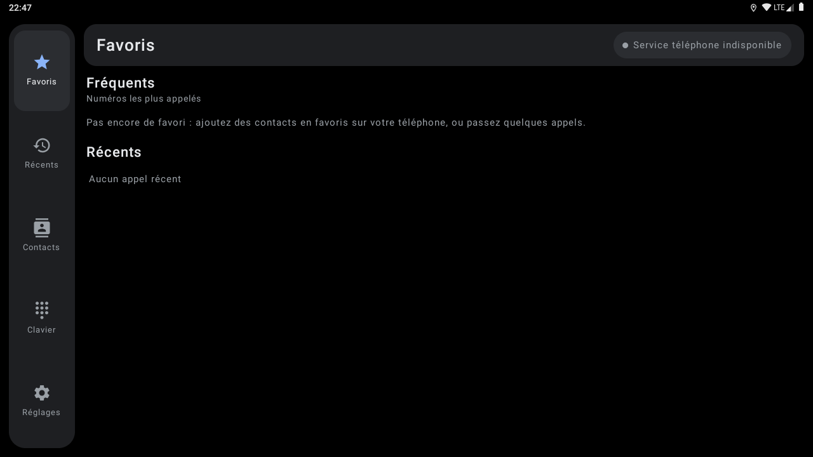
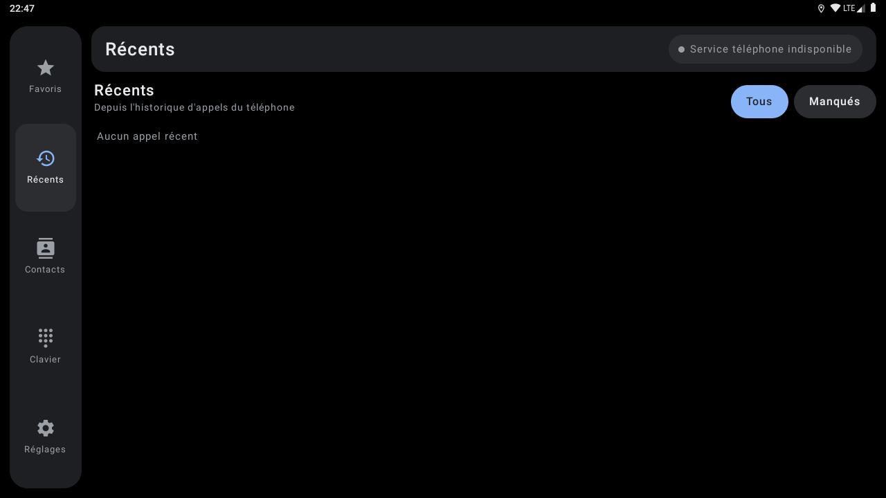
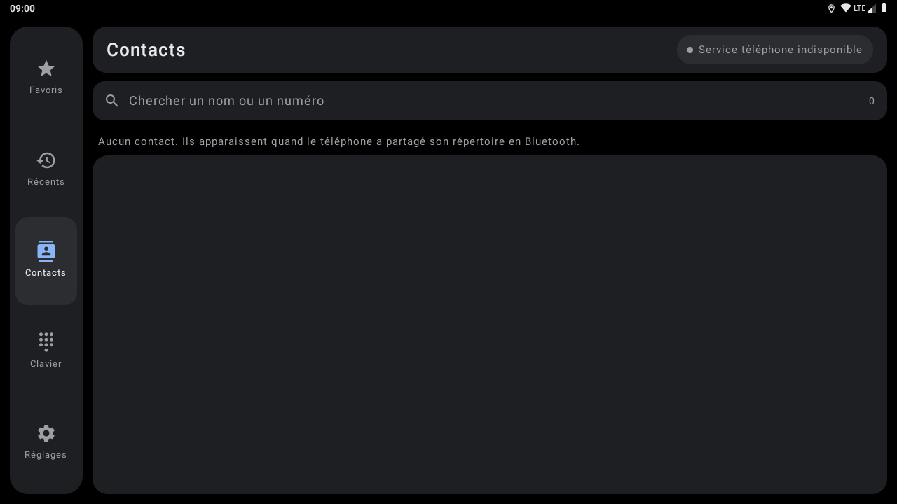
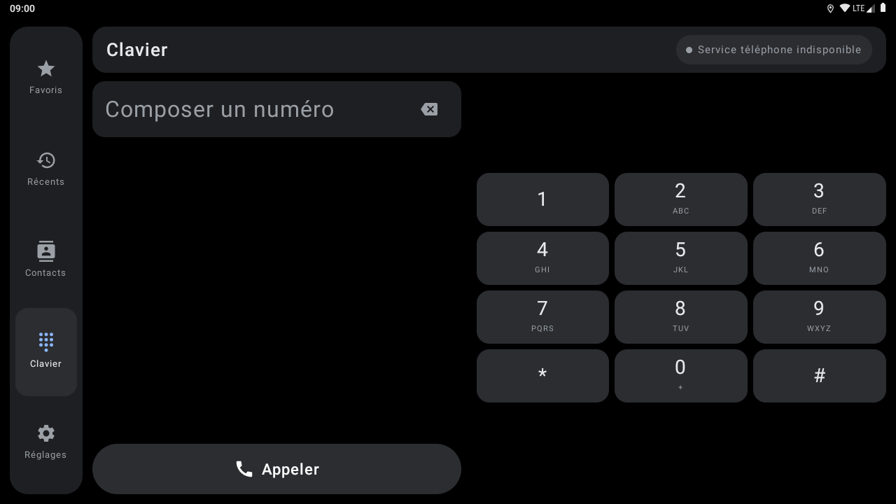
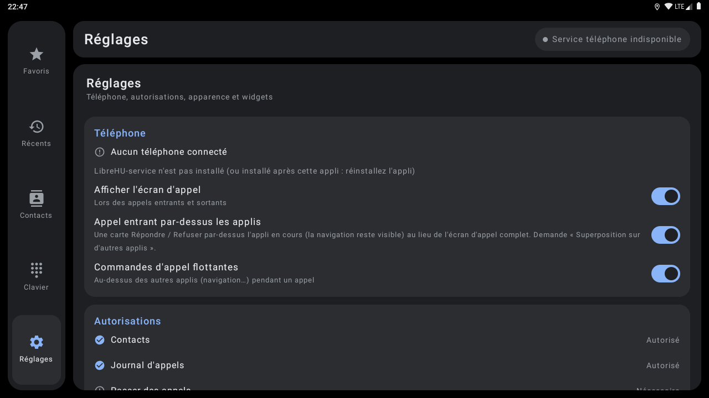
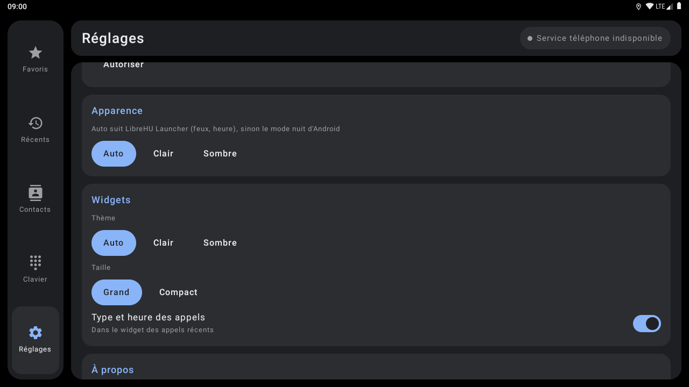
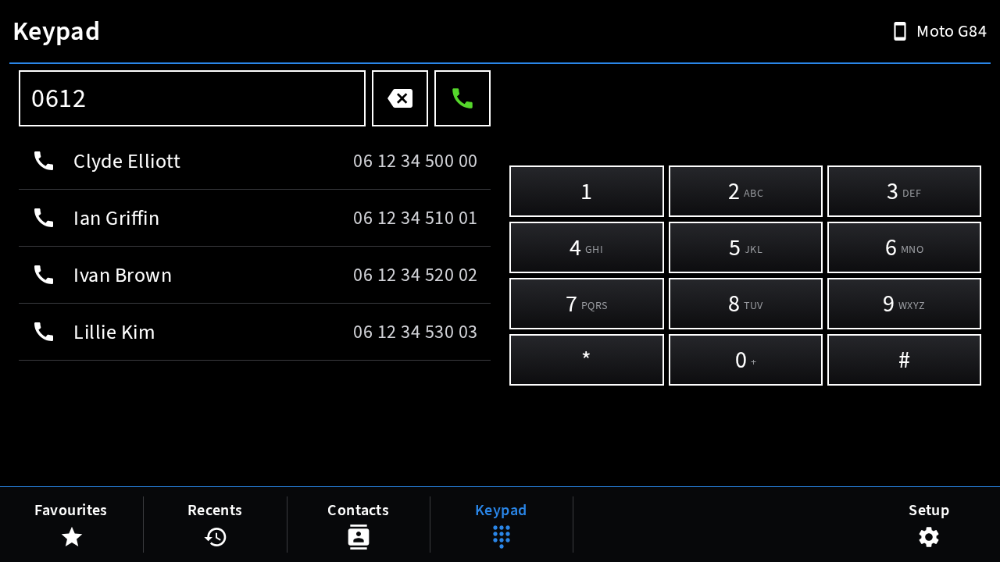
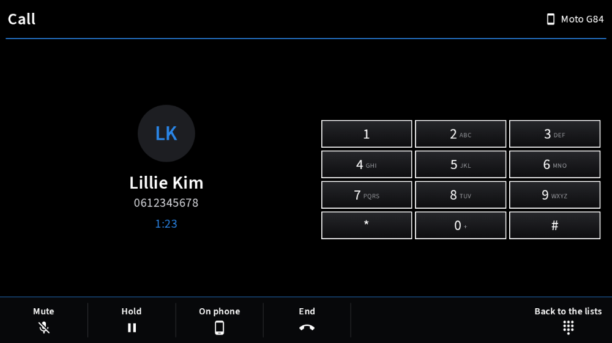
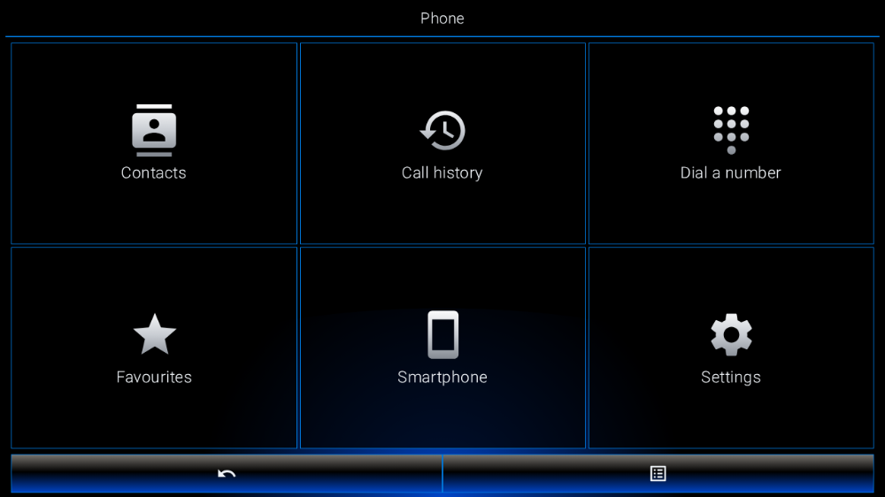
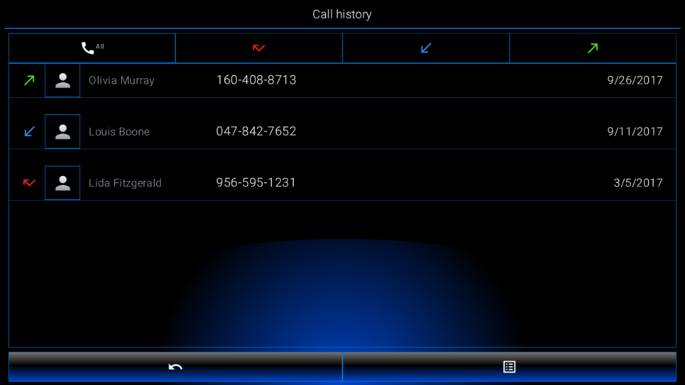

# LibreHU Dialer

Application téléphone pour autoradios LibreHU (UJC201 / AC8257, Android 9), pensée pour la voiture : grandes
cibles tactiles, paysage, thème et accent synchronisés avec [LibreHU Launcher](https://github.com/LibreHU/LibreHU-Launcher-App).
Inspirée de l'ergonomie d'Android Auto, sans en être un client ni reprendre ses éléments graphiques.

## Captures d'écran

| | |
|---|---|
| <br>Favoris | <br>Récents |
| <br>Contacts | <br>Clavier |
| <br>Réglages | <br>Réglages (2) |
| <br>Style Modularer Infotainment-Baukasten : clavier | <br>Style Modularer Infotainment-Baukasten : appel |
| <br>Style LHU-Link : menu | <br>Style LHU-Link : historique |

Captures sur l'émulateur Android 9 (1280×720, 160 dpi comme l'autoradio), sans autoradio branché : les valeurs du véhicule et de la MCU sont vides. Refaites-les avec l'action **Screenshots** de [LibreHU-OTA-app](https://github.com/LibreHU/LibreHU-OTA-app/tree/main/screenshots). Galerie : [librehu.github.io/screenshots/dialer.html](https://librehu.github.io/screenshots/dialer.html).

## Fonctions

- **Favoris** : contacts favoris du téléphone (sinon les numéros les plus appelés) et derniers appels.
- **Récents** : journal d'appels (reçus, émis, manqués en rouge, refusés), regroupement des appels consécutifs,
  filtre « Manqués ».
- **Contacts** : répertoire avec photos, index alphabétique, recherche par nom ou numéro, choix du numéro quand un
  contact en a plusieurs.
- **Clavier** : grandes touches, appui long sur 0 pour « + », appui long sur effacer pour tout effacer, suggestions
  de contacts pendant la saisie, par numéro ou par **recherche T9** (5-3-6 trouve « Jean » : début du nom, début
  d'un mot, puis initiales ; 4 suggestions) ; ouvre aussi les liens `tel:` et l'action `DIAL` des autres applis.
- **Écran d'appel** : appel entrant (répondre / refuser, double appel), durée, micro coupé, clavier DTMF, mise en
  attente, permutation entre deux appels, raccrocher ; réductible en barre au-dessus des listes.
- **Commandes flottantes** pendant un appel, par-dessus les autres applis (navigation…) : nom, durée, micro,
  raccrocher, déplaçables ; un toucher rouvre l'écran d'appel (autorisation « affichage par-dessus »).
- **Appel entrant par-dessus les applis** : carte façon Android Auto (initiale, nom, numéro, Refuser / Répondre) au
  lieu de l'écran d'appel complet, aux couleurs du launcher ; devient les commandes flottantes une fois décroché.
- **En-tête** : réseau du téléphone (barres, opérateur, itinérance, « Pas de service », batterie) lu sur le profil
  HFP, à la place de l'heure.
- **Widgets** : raccourcis (favoris), derniers appels et **clavier** (12 touches, effacer, appeler : l'appel
  passe par l'appli), thème et couleur d'accent du launcher.
- Français et anglais.

## Branches

| Branche | Moteur téléphone | Comment |
|---|---|---|
| `main` | **Android Telecom** | L'appli devient l'**appli téléphone par défaut** (Réglages → Téléphone). Les appels du téléphone Bluetooth sont des appels Telecom créés par le service HFP client d'Android (`com.android.bluetooth`) : l'`InCallService` de l'appli les reçoit, `TelecomManager.placeCall` les passe. |
| `ivi` | **Jancar `ivi-btservice`** | Binder `com.jancar.btservice.bluetooth.IBluetooth` (ROM d'origine). Voir [docs/jancar-binder-contract.md](https://github.com/LibreHU/LibreHU-dialer-app/blob/ivi/docs/jancar-binder-contract.md) sur la branche `ivi`. |
| `librehu-service` | **[LibreHU-service](https://github.com/LibreHU/LibreHU-service)** | API Bluetooth `ILibreHuBluetooth` (API 3) : appels, état du téléphone, audio voiture / téléphone. |

Seuls `phone/PhoneBackends.kt`, le moteur et le manifeste diffèrent entre branches : l'interface reste commune
(`phone/PhoneModel.kt`).

## Architecture

```
org.librehu.dialer
├── MainActivity.kt        intents (tel:, DIAL, onglet, écran d'appel), autorisations, appli par défaut
├── CallBubble.kt          commandes flottantes (fenêtre superposée)
├── phone/                 PhoneBackend (interface), moteur de la branche, Phone (instance partagée)
├── data/PhoneBook.kt      contacts, journal, favoris, recherche de nom (fournisseurs Android)
├── data/T9.kt            recherche T9 (nom → chiffres, score début de nom / de mot / initiales)
├── ui/                    écrans Compose (onglets, appel, réglages), thème partagé avec le launcher
├── DialerWidgets.kt       widgets raccourcis et derniers appels
├── DialerKeypadWidget.kt  widget clavier (numéro par widget, appel via MainActivity)
└── ThemeFollower.kt       thème du launcher (content://org.librehu.launcher.theme/theme + THEME_CHANGED)
```

Contacts et journal : sur l'autoradio, le client PBAP d'Android télécharge le répertoire et l'historique du
téléphone dans les fournisseurs `ContactsContract` / `CallLog` (ce que relisent aussi `ivi-btservice` et
LibreHU-service) : l'appli les lit directement.

Règles :

- Ne jamais ouvrir l'UART de la MCU (`/dev/ttyS1`) : LibreHU-service en est le seul propriétaire.
- Afficher honnêtement les états « non connecté » / « indisponible » ; ne jamais simuler un appel.

## Appli téléphone (LibreHU Bridge)

Réglable depuis le téléphone par l'appli LibreHU Bridge (Android et iPhone), à travers LibreHU-service : appels (ouverture sur appel, fenêtre d'appel entrant, bulle), apparence et widgets.
Fournisseur `<paquet>.bridge` (`bridge/BridgeProvider.kt`), réservé aux applis signées avec la clé LibreHU (permission
`org.librehu.permission.BRIDGE`, vérifiée dans `call()` lui-même) ; format décrit dans
[LibreHU-service, docs/bridge.md](https://github.com/LibreHU/LibreHU-service/blob/main/docs/bridge.md).

## Compilation

JDK 17, SDK Android API 37. GitHub Actions : `gradle assembleRelease`, artefact `LibreHU-Dialer` et release `latest-<branche>` (installable avec
[LibreHU Apps (OTA)](https://github.com/LibreHU/LibreHU-OTA-app)).

Non testé sur l'autoradio à ce stade.

## Optimisation (R8)

L'APK publié par la CI (`assembleRelease`) est **optimisé par R8** : code et ressources réduits et optimisés, ce qui
rend Jetpack Compose nettement plus fluide ([Compose performance](https://developer.android.com/develop/ui/compose/performance)),
**sans renommage** (`-dontobfuscate` dans `app/proguard-rules.pro`) : les traces des journaux restent lisibles. Les
règles gardent aussi ce qui n'est appelé que par son nom (méthodes natives, helpers root lancés par `app_process`). Si
une fonction plante avec « class / method not found », regarder `usage.txt` dans l'artefact *R8 reports* de la CI (ce
que R8 a retiré) et ajouter une règle `-keep`.

**Styles Modularer Infotainment-Baukasten et LHU-Link de LibreHU Launcher** : c'est le launcher qui les choisit et les demande à l'appli (il publie `style` = `factory` ou `ambient`, comme pour le style rétro) ; l'appli suit tout de suite : palette noire du style même en mode jour, coins carrés partout, police Source Sans 3 pour Modularer Infotainment-Baukasten (SIL OFL 1.1, `third_party/SourceSans3-LICENSE.md`), lettres fines pour LHU-Link. Rien à régler dans l'appli.

Les **fenêtres** (confirmations, choix, listes) suivent aussi le style : boîte noire à filet blanc (Modularer Infotainment-Baukasten) ou bleu nuit à filet d'accent (LHU-Link). L'onglet **Réglages** prend les sections, interrupteurs et choix du style.

**Son des touches** : chaque toucher (sans glisser ni appui long) fait le petit son choisi dans LibreHU Launcher
(Paramètres → Personnalisation → Son des touches : un son par style parmi 26, ou aucun) ; le launcher le publie
(colonne / extra `click`), un launcher plus ancien donne le son par défaut de son style. Sons de LibreHU (synthétisés),
de **Kenney** ([kenney.nl](https://kenney.nl/assets/interface-sounds), CC0, version WAV de **Hugo Locurcio (Calinou)** :
[Calinou/kenney-interface-sounds](https://github.com/Calinou/kenney-interface-sounds)) et de l'**Android Open Source
Project** (sons tactiles, Apache 2.0) : détail et licences dans `third_party/KEYCLICK-SOUNDS.md`
(`res/raw/click_*.wav`, `ui/KeyClick.kt`).

Les écrans prennent aussi la **mise en page** de ces styles (`ui/DialerStyled.kt`, éléments communs dans `ui/CarKit.kt`) :

- **Modularer Infotainment-Baukasten** : titre de l'écran sur un trait de la couleur d'accent, téléphone connecté à
  droite ; Favoris en tuiles (puis les derniers appels), Récents (Tous / Manqués), Contacts par lettre, Clavier
  (numéro encadré, effacer, appeler, contacts trouvés par numéro ou T9, touches encadrées) ; touches du bas Favoris,
  Récents, Contacts, Clavier, Appel (pendant un appel réduit), Réglages. Pendant un appel, les touches du bas
  deviennent celles de l'appel (Décrocher / Refuser, ou Muet, Attente / Permuter, Sur le téléphone, Raccrocher,
  Retour aux listes) et le clavier DTMF est à droite.
- **LHU-Link** : menu **Téléphone** de six tuiles (Répertoire, Historique des appels, Composer un numéro, Favoris,
  Smartphone = réglages Bluetooth d'Android, Réglages) ; Répertoire avec la lettre dans un carré gris, la photo
  encadrée et la fiche du contact (grande photo encadrée, une ligne par numéro) ; Historique avec ses quatre filtres
  en icônes (tous, manqués, reçus, émis) ; Composer un numéro (champ, effacer, touches encadrées) ; écran d'appel
  (grande photo encadrée, nom, numéro, durée, touches Attente / Sur le téléphone / Muet / Clavier). Barre du bas :
  Retour, l'action de l'écran (Chercher, Appeler, Raccrocher, Refuser / Répondre) et Options. Le menu est sauté quand
  une autre appli demande un onglet (`org.librehu.dialer.extra.OPEN_TAB`, lien `tel:`).

Mise en page reprise des styles de LibreHU Launcher, avec les icônes Material de LibreHU : aucun logo, nom, icône,
police ni image d'un constructeur.

**Style rétro et police de LibreHU Launcher** : quand le launcher est en style rétro (les couleurs d'un afficheur
d'autoradio tirées de sa couleur d'accent, couleur RGB comprise), cette appli prend sa palette (jour ou nuit) ; quand
la **police d'afficheur à segments** y est choisie (dans tous les styles), cette appli la prend aussi, en majuscules
sans accents (« LibreHU Seg14 », tirée de DSEG14 © keshikan, SIL Open Font License 1.1, voir
`third_party/DSEG-LICENSE.txt`). Le launcher publie le style, la police et la palette par
`content://org.librehu.launcher.theme/theme` (colonnes `style`, `font`, `background`, `surface`, `surface_high`,
`on_accent`, `text`, `text_dim`) et par la diffusion `org.librehu.action.THEME_CHANGED` (mêmes noms en extras).

**Widgets** : mêmes couleurs rétro et même police. Un widget Android 9 ne peut pas utiliser la police d'une appli
(TextView ne charge pas de police dans le contexte restreint de l'écran d'accueil) : avec la police à segments, chaque
texte est dessiné en image (`SegmentViews` : le TextView lui-même, avec la police à segments, mis en page à la
taille du widget, donc coupé avec « … », aligné et sur ses lignes comme d'habitude) et affiché par une ImageView
`<id>_seg` placée comme lui, ajoutée à côté de
chaque texte des layouts `widget*.xml` par `tools/segment_widgets.py` (à relancer après avoir modifié un layout de
widget). Les fonds rétro sont des couleurs unies (Android 9 ne teinte pas un fond de widget ; la case arrondie du
launcher les découpe).

## Soutenir le projet

LibreHU est développé bénévolement, sur le temps libre, et toutes ses applis restent gratuites. Si le projet vous est
utile, vous pouvez le soutenir par un don sur [Liberapay](https://liberapay.com/DokT/donate) (association française à
but non lucratif, dons récurrents) :

[](https://liberapay.com/DokT/donate)
[](https://liberapay.com/DokT/)
